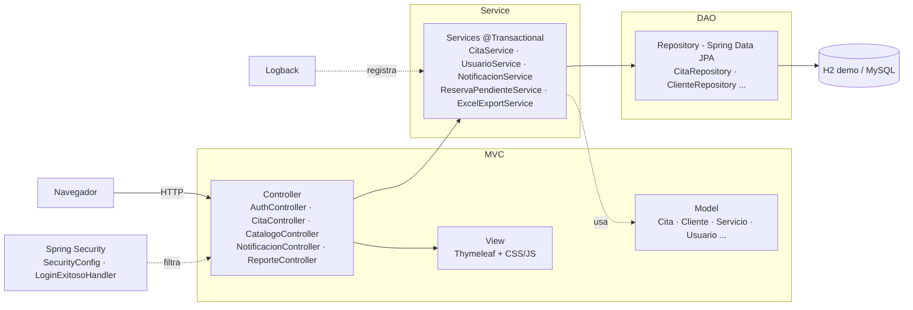
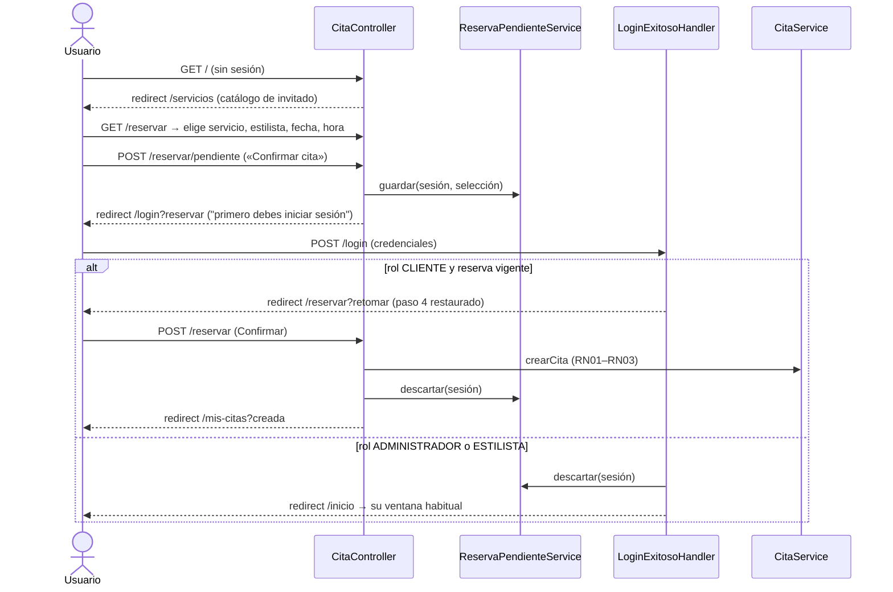
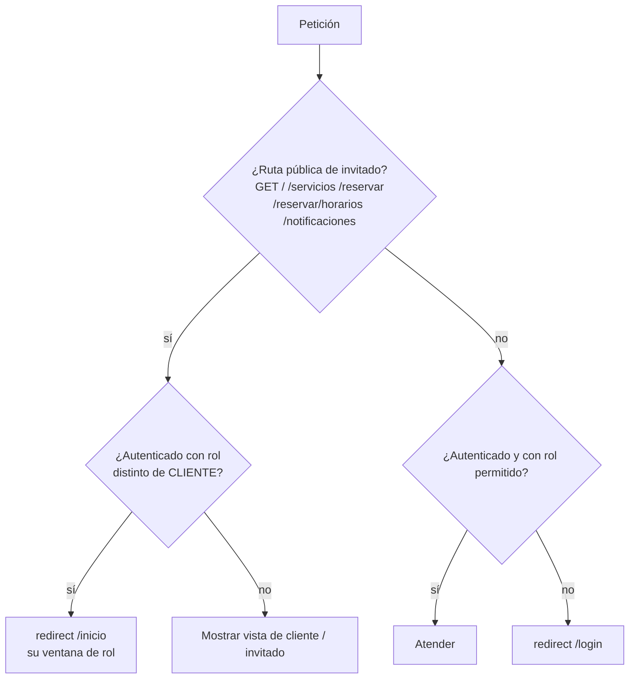

# Diagramas de arquitectura · Bella Estilo

> Los diagramas están en Mermaid: se visualizan directamente en GitHub y en VS Code (extensión *Markdown Preview Mermaid Support*).

## 1. Arquitectura por capas (MVC + DAO)

## 2. Flujo de acceso: invitado → login → reserva

## 3. Decisión de acceso por ruta

## 4. Principios SOLID y patrones aplicados

| Principio / patrón | Dónde se aplica |
|---|---|
| **S** – Responsabilidad única | `LoginExitosoHandler` (solo decide destino), `Acceso` (solo consulta de rol), `Privacidad` (solo enmascarar), `ExcelExportService` (solo generar Excel) |
| **O** – Abierto/cerrado | Nuevas reglas de redirección se agregan en el handler sin modificar `SecurityConfig` ni los controladores |
| **L** – Sustitución de Liskov | `ReservaPendienteSesionService` puede sustituirse por otra implementación (p. ej. en base de datos) sin cambiar a quien la usa |
| **I** – Segregación de interfaces | `ReservaPendienteService` expone solo 3 operaciones (`guardar`, `obtenerVigente`, `descartar`) |
| **D** – Inversión de dependencias | Controladores y handler dependen de la interfaz `ReservaPendienteService`, no de la clase concreta |
| **MVC** | Controller (`controller/`) · View (`templates/`) · Model (`model/`, `dto/`) |
| **DAO** | `repository/` (Spring Data JPA): único punto de acceso a la base de datos |
| **TDD** | Pruebas unitarias e integración en `src/test` para cada regla del flujo de invitado |
